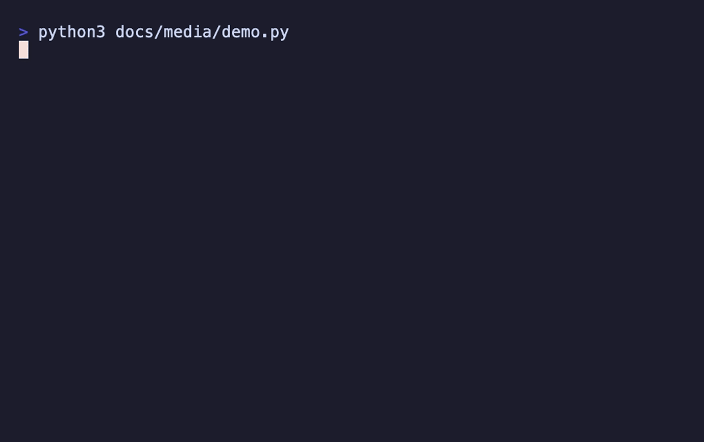
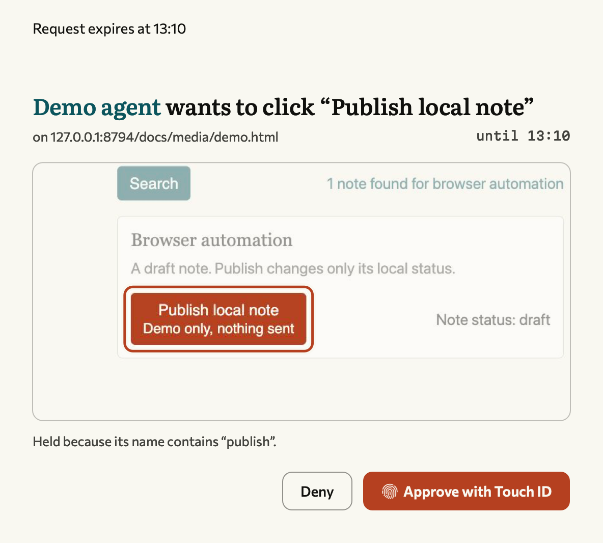
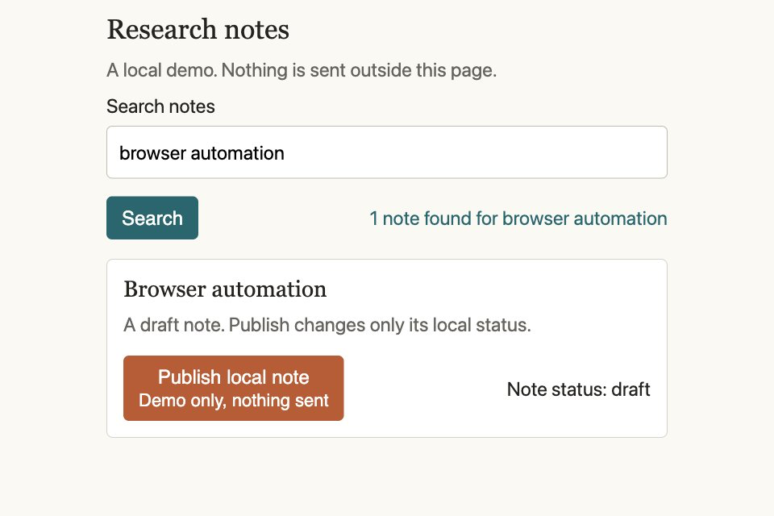

<h1> </h1>

Gaddi is a local [MCP](https://modelcontextprotocol.io/) server that lets AI agents work in your existing Chrome tabs.

Agents use your existing logins, open background task groups, read pages and interact with controls.

I built it to work with MCP-capable agents without taking focus from my other apps.

[](https://github.com/ABCastor/gaddi/actions/workflows/checks.yml)



## Read with OmniRead

[OmniRead](https://github.com/ABCastor/omniread) is Gaddi’s reading companion. Gaddi captures the page in your signed-in tab; OmniRead extracts Markdown, indexes its sections and reports evidence of missing content. Together, an agent can read a subscriber article, request one section and distinguish a full capture from an abstract or blocked page. A completeness verdict is evidence, not a guarantee.

## You authorize the action

**A held action waits for you to confirm it in Gaddi's Mac panel.** Telling the agent "yes" does not create that signature.

A local broker checks each request before Chrome. The default policy holds recognized payments, purchases, deletion, security changes and sends, plus all uploads. Gmail Send and direct password-field access are refused.



The panel names who asked (the agent, its chat and project), the action, the agent's one-line reason and what approving allows, and can show the target. Agents pass the reason as `why`; see [who asked and why](docs/authorization.md#who-asked-and-why). Touch ID or your Mac password authorizes a [Secure Enclave](https://support.apple.com/guide/security/secure-enclave-sec59b0b31ff/web) key to sign your decision. Approval binds to the pending action; changed requests and reused proofs fail. The button labelled “Approve with Touch ID” also accepts the Mac password. There is no software-key fallback.

Sign-ins, eligible sends and uploads can remember a site after a signed decision. The shipped lists are empty. Remembered uploads still hold on protected pages and refuse protected files. Payments, deletion and security actions cannot be remembered. See [authorization details](docs/authorization.md).

### Grant one chat a few holds

An agent can ask once, at the start of a chat, for a session grant: a short list of held actions it may then take without asking, each tied to an address prefix.

```text
browser_grant  rules: ["upload https://github.com/settings/profile", "post https://www.linkedin.com/company/123/admin"]
               minutes: 180   label: "Update the org profile and post the launch note"
```

Gaddi shows the rules, the length and the agent's label on one card. **The grant exists only after you approve that card**, with Touch ID, or from your phone if you turned that on (below). It covers the chat that asked and no other, and ends when the time runs out, when that chat closes, when you press **End now** in the panel, or when the broker restarts. Only uploads, posts and deletes can be granted. Payments, purchases, sends, sign-in and security changes stay held every time, and a button whose name mixes a granted verb with another hold verb stays held. Keep prefixes narrow: a grant on `github.com/settings` would also cover its key and token pages. Details are in [authorization](docs/authorization.md#session-grants).

### Approve from your phone (off by default)

A local bot on your Mac, such as a Telegram bot, can answer the same small set of requests from your phone: uploads, posts and deletes on pages that are not protected, and session grants of up to two hours. You turn it on once in Gaddi's panel with Touch ID, which trusts one Ed25519 key the bot published; anyone can turn it off, from the panel, `gaddi remote off` or the bot. Each phone answer is signed, bound to one request and usable once, and the panel lists recent ones. Payments, purchases, sign-in, security pages and sending messages stay Touch ID only. The bot's key is a file your user account can read, so another program running as you could approve these requests too; that is why the scope stays small. The contract is in [authorization](docs/authorization.md#approvals-from-another-device).

### Where that protection ends

Gaddi guards its own calls. An agent with shell access can act outside it. Policy matches control names and URLs, mainly in English and Italian; it can miss harmful actions and obfuscated JavaScript. Pages can send requests on their own.

Private information visible in logged-in tabs goes to your agent. The extension needs broad site, debugger, bookmark and extension-management access. Review the [default policy](policy/policy.default.json) and [bridge limits](extension/README.md).

## Install

Requires macOS 26+, a Mac with Secure Enclave, [Chrome](https://www.google.com/chrome/) 120+, [Node.js](https://nodejs.org/) 22.18+ on the 22.x line or 23.6+, and Xcode 26+ to build the approval app. This is a source installation with an ad-hoc-signed Mac app.

```sh
git clone https://github.com/ABCastor/gaddi.git
cd gaddi
npm ci
bash install/register/daemon.sh
bash install/register/app.sh
bash install/register/chrome-bridge.sh
```

In `chrome://extensions`, enable Developer mode and **Load unpacked** from `extension/`. Add `~/.local/bin` to your PATH. Keep the checkout: installed components reference it. The Chrome bridge needs `node` on its non-login PATH; version-manager installations may need an accessible binary in `/opt/homebrew/bin` or `/usr/local/bin`.

Quit your client before registration, then restart it.

| Client | Command |
|---|---|
| [Claude Code](https://code.claude.com/docs/en/overview) | `bash install/register/claude-code.sh` |
| [Claude Desktop](https://claude.ai/download) | `bash install/register/claude-desktop.sh` |
| [Codex](https://developers.openai.com/codex/) | `bash install/register/codex.sh` |
| [OpenCode](https://opencode.ai/) | `bash install/register/opencode.sh` |
| Antigravity | `bash install/register/agy.sh` |

Other clients can launch `node /absolute/path/to/gaddi/mcp/server.mjs` over stdio. Installers accept `--dry-run`. See [configuration and removal](install/README.md).

## Work in a tab

```sh
gaddi status
gaddi open https://example.com --group "Research"
gaddi look <tab-id>
gaddi click <tab-id> '<element-ref>'
gaddi close <tab-id>
```

`open` returns a tab ID; `look` returns text and control references. Keep the ID through the task. New tabs use Gaddi's own window, created minimized. You can open it from Chrome's Dock menu; Gaddi leaves its size, position and state as you set them. MCP tools use a `browser_` prefix and also support typing, scrolling (sideways too, with `dx`, and inside a carousel or grid when you name it), selection, waits and screenshots.

A click can go where you point instead of at a reference: `gaddi click <tab-id> --at 120,240` (`at:{x,y}` over MCP) presses that point in the tab as your own mouse would, which is how a button under a cookie banner, or a control inside a third-party embed, is reached. `look` also lists every document inside the tab with its frame id; `--frame <id>` (`frameId`) makes `look`, `click`, `type`, `press`, `hover`, `select`, `scroll`, `wait` and `upload` work inside that document, cross-origin included, and keys go in once that document is the inspected target and holds the focus. The gates follow the click: a point is judged on the control under it, a click inside an embed is judged on that site as well as on the page, a file sent to a field inside another site's embed asks every time (a remembered upload site covers its own pages only), a wheel inside a document needs a `selector` to aim at, and a point over something Gaddi cannot inspect waits for you. Verification widgets are named as such in `look`; pressing their checkbox is your own click, and Gaddi never answers a puzzle. Rendering actions run in background tabs. `browser_show` selects a tab and requests your attention without taking window focus by default.



`look` returns `positions` for its outlined references: `{ref, x, y, width, height}` in the inspected document's viewport, in CSS pixels. Use these to associate controls with visual rows; the outline keeps semantic document order, which may be the reverse of screen order. Inside an iframe these are not the parent tab's click coordinates. Geometry does not establish that an embedded document is on screen or authorize a click. Native `select` is a convenience that dispatches synthetic events; it does not promise `isTrusted` input.

Pass the version from `look` to reject stale input. When a session ends, its background tabs are cleaned up; tabs shown to you are preserved.

`browser_read` uses [OmniRead](https://github.com/ABCastor/omniread) to extract Markdown, sections and completeness information from page HTML, including logged-in tabs. Install it before registering your client, or set `OMNIREAD_BIN`. Without it, Gaddi returns page text without sections or continuation handles.

### Sign in with 1Password

`browser_signin` uses the [1Password CLI](https://developer.1password.com/docs/cli/) and desktop-app integration, without needing the browser's password-manager extension. You authorize the site and Login item; Gaddi fills it. A locked or unavailable CLI returns an unlock/retry instruction after a five-second process budget. Agents can work through visual challenges with screenshot/click; passkeys and extra verification can need you.

For a new account, pass `create:{title,username,vault}`. You approve the new item and vault; `op` generates and saves its password, then Gaddi fills the signup form without submitting. Use `signup:true` with `item` to fill an already saved login. Submit with an ordinary click, keeping its existing approval rules. See [the sign-in contract](docs/authorization.md#new-accounts-and-a-locked-password-manager).

Credentials stay out of sign-in results and audit entries. Text output redacts exact matches for ten minutes after use; screenshots do not. Credential-bearing URL query/fragment values are redacted independently, across results, errors, events and stored broker metadata. Navigation and signed approvals still use the original URL. Existing broker state and audit files are scrubbed at startup; client transcripts and Chrome history are not. See [URL credentials](docs/authorization.md#url-credentials).

Uploads have a 20 MB limit. Protected credential paths and key files are refused; arbitrary files can still contain secrets. See [extension controls](docs/extension-controls.md). Connection recovery does not resubmit pending page actions.

### When Chrome stops

If Chrome has quit or crashed, the next browser call reopens it in the background with your normal profile and last session (`open -a`, never a fresh profile), waits up to 45 seconds for the extension, and tells the agent and you once (a Gaddi banner) what happened. It reopens Chrome at most once per 10 minutes and three times an hour, for a stopped browser. If three consecutive bridge requests time out within five minutes, or the native host disconnects for at least 15 seconds, `browser_status` reports `stalled`. On the next browser call, Gaddi asks Chrome to quit gracefully, waits up to 20 seconds for it to exit, then reopens your normal profile and last session. If Chrome refuses to quit, recovery stops without force-killing it. The extension must reconnect and answer a tabs request before recovery succeeds. Gaddi attempts this restart at most once per 30 minutes, remembers the limit across broker restarts, records the reason in its audit, and shows the outcome in status and a Gaddi banner. Nothing reopens Chrome until an agent needs it.

## Development

```sh
npm run typecheck
npm run build:extension
bash tests/run-all.sh
```

Tests use isolated state and falsify gates by removing their protection. Browser tests need Chrome for Testing; Secure Enclave checks need a desktop session. Missing prerequisites are skipped. Commit regenerated extension output after changes. [Visual sources](docs/media/README.md) are included.

`browser_click` accepts `download:"/absolute/path/export.zip"` for an approved, same-origin blob/filesystem anchor export that reaches the top document. It saves a new file under Downloads or the system temporary directory, up to 20 MiB, with no overwrite. Detached anchors, other download methods and embedded documents are unsupported. See [the bounded download contract](docs/authorization.md#page-generated-downloads).

There is no console or network inspection, general download manager, browser-dialog handling or video recording. CSS and Web Animations can be slowed; JavaScript timers, canvas and video cannot.

Original code is licensed under [Apache-2.0](LICENSE). Bundled fonts, the Public Suffix List and dependencies keep their own licenses; see [NOTICE](NOTICE).

<p><a href="https://abcastor.com"></a></p>
